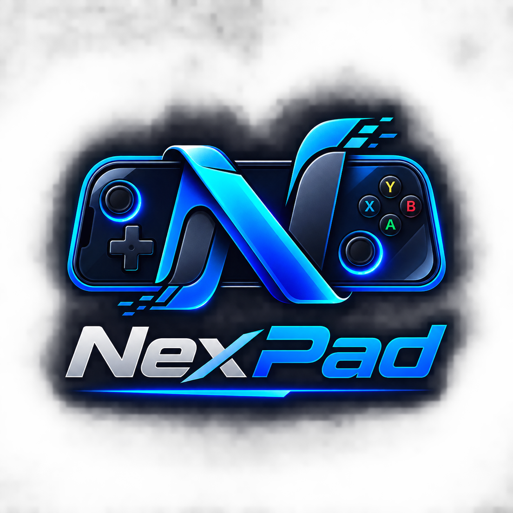

# 🎮 NexPad — Ultra-Low Latency Virtual Gamepad & Racing Wheel for PC

  

  <b>Turn your Android phone into an ultra-low latency (<1ms USB / <3ms Wi-Fi) Xbox 360 Controller & Racing Wheel with Gyro Aiming and Haptic Rumble for PC gaming.</b>

  
  
  
  
  
  
  
  

---

## 📥 Downloads (Latest Release v1.2.2)

| Package | Description | Direct Download |
| :--- | :--- | :--- |
| **🚀 NexPad Windows Installer** | **Recommended.** 1-Click setup with ViGEmBus drivers, server, APK & uninstaller embedded. | [**Download `NexPad_Setup.exe`**](https://github.com/SushantSaks/NexPad/releases/latest/download/NexPad_Setup.exe) *(16.8 MB)* |
| **📱 NexPad Android App** | Dedicated Android APK with Tilt-to-Move deflection aiming, GitHub updates & haptic rumble. | [**Download `NexPad.apk`**](https://github.com/SushantSaks/NexPad/releases/latest/download/NexPad.apk) *(7.04 MB)* |
| **📦 NexPad Portable** | Standalone zip containing Windows server and Android APK without installer. | [**Download `NexPad_Portable.zip`**](https://github.com/SushantSaks/NexPad/releases/latest/download/NexPad_Portable.zip) *(14.0 MB)* |

---

## ✨ What's New in v1.2.2

* 🎮 **Tilt-to-Move Deflection Aiming (Tilt = Move, Normal = Stop)**:
  * **Slight Tilt = Slow Tracking**: Tilting the phone slightly past the neutral deadzone pushes the virtual right stick gently past in-game deadzones, smoothly moving the camera slowly in that direction.
  * **Return to Normal = Stay in Place**: Returning the phone back to your normal resting position immediately centers the stick to `(0, 0)`, stopping the camera dead in its tracks right where it reached.
  * **Deep Tilt = Fast Sweeping**: Tilting further accelerates the stick along a progressive power curve for rapid 90°/180° camera turns.
  * **Selectable Aiming Style**: Switch seamlessly between **Tilt-to-Move (Joystick Deflection)** and **Motion Velocity (Raw Gyro Sweeping)** in Settings.
  * **1-Tap Normal Calibration**: Tap *"Calibrate Normal Position"* to lock in whatever angle you're holding your phone comfortably as the exact (0, 0) baseline.
  * **Auto-Neutral on Aim Down Sights (ADS)**: Pressing LT or touching the Right Stick automatically snapshots your current grip as neutral.
* 🎯 **Fixed Gyro Aiming & Motion Steering (Zero Lingering Spin)**:
  * Rebuilt the gyro input pipeline so rotational velocity is calculated as instantaneous offsets rather than persistent stick accumulation.
  * **Continuous Auto-Drift Nulling**: Stillness zeroing automatically adapts to hardware MEMS bias, eliminating creeping rotation.
* 🚀 **In-App Direct GitHub Update System**:
  * The Android app automatically checks GitHub Releases on startup in the background.
  * Adds an update notification badge (`✨ vX.X.X`) to the top HUD capsule and a **"Check for Updates"** button in Settings.
  * Themed in-app dialog displays release highlights with a 1-tap **"Download APK"** button.

---

## ✨ Core Features

### 🎯 1. High-Precision Gyro Aiming & Motion Steering
* **Console-Grade Motion Controls**: Aim with micro-adjustments in shooters or steer naturally by tilting your device.
* **Activation Triggers**:
  * **Always Active**: Continuous motion tracking for seamless racing and flying.
  * **Hold LT (ADS Aiming)**: Engages gyro only while aiming down sights for pinpoint sniper precision.
* **Granular Customization**: Adjustable sensitivity (0.1x to 3.0x), anti-drift noise gate, axis inverters, and instant flat calibration.

### 📳 2. Real-Time Force Feedback Haptic Rumble
* Direct PC-to-phone haptic actuation via ViGEmBus vibration streaming.
* Feel gunshots, engine revs, curb impacts, and explosions through dynamic vibration waveforms.

### 👥 3. Up to 4-Player Simultaneous Multiplayer
* Connect up to **4 Android phones simultaneously** to a single PC server over Wi-Fi, USB, or PC Mobile Hotspot.
* Windows recognizes each phone as a distinct **Xbox 360 Controller (Player 1, Player 2, Player 3, Player 4)**.
* Perfect for local co-op & split-screen games: **FIFA / EA FC, Rocket League, Overcooked, It Takes Two, Blur, Gang Beasts, and emulators**.

### 🏎️ 4. Dedicated Driving & Racing Wheel Layout
* **Virtual Steering Wheel**: Natural angular touch rotation with realistic spring return-to-center physics.
* **Customizable Steering Range**: Adjust lock-to-lock rotation from **±45° up to ±720° (2 full turns)** with quick presets (`±45°`, `±90° F1`, `±180° GT3`, `±270° Rally`, `±360°`, `±540° Drift`, `±720° Pro Sim`).
* **Analog Racing Pedals**:
  * **Accelerator Pedal (`GAS / RT`)**: Progressive analog throttle with live percentage display (`0% - 100%`).
  * **Brake Pedal (`BRAKE / LT`)**: Heavy-duty progressive braking with live percentage display.
* **Tactical Racing Controls**: Dedicated **`E-BRAKE (A)`** drifting button, **`⚡ BOOST (B)`**, paddle shifters (`LB / RB`), and auxiliary view controls.

### 🎮 5. Full Standard Gamepad (Xbox 360 / XInput)
* Dual analog thumbsticks (`LS`, `RS`) with customizable deadzones and sensitivity.
* Tactile action buttons (`A`, `B`, `X`, `Y`), unified D-Pad, bumpers (`LB`, `RB`), analog triggers (`LT`, `RT`), click sticks (`L3`, `R3`), and system buttons (`VIEW`, `MENU`, `GUIDE`).
* Works natively with **Steam, Xbox Game Pass, Epic Games Store, EA Play, Ubisoft Connect, RPCS3, PCSX2, Dolphin, Yuzu, Ryujinx, and Cemu**.

### ✏️ 6. Full Layout Customizer (Edit Mode)
* Drag and move any button anywhere on screen.
* Resize individual controls from **0.60x to 2.00x**.
* Grid snapping (`Snap: ON/OFF`), undo / redo stack (up to 25 steps), and reset to default.
* Save custom configurations to **User Presets** for different genres.

### 🎨 7. 6 Dynamic Hardware Themes
* **Cyber Cyan**: Neon cyan accents with dark obsidian backing.
* **Stealth Black**: Matte blackout aesthetics with tactical carbon styling.
* **DualSense Slate**: PlayStation glyphs (`✕`, `○`, `□`, `△`) on premium slate.
* **Xbox Emerald**: Iconic green accents with authentic Xbox button colorways.
* **Synthwave Neon**: Hot pink & retro purple 80s aesthetics.
* **Crimson Viper**: Blood-red racing cockpit theme.

---

## 🚀 Quick Start Guide

### Step 1: Install on PC
1. Download and run [**`NexPad_Setup.exe`**](https://github.com/SushantSaks/NexPad/releases/latest/download/NexPad_Setup.exe).
2. The installer will automatically install the ViGEmBus controller driver (if missing) and create desktop shortcuts.
3. Launch **NexPad** from your Desktop.

### Step 2: Install on Android Phone
1. Connect your phone via **Wired USB Tethering** (lowest latency <1ms) or to the same Wi-Fi network / PC Mobile Hotspot.
2. Install [**`NexPad.apk`**](https://github.com/SushantSaks/NexPad/releases/latest/download/NexPad.apk) on your phone.
   *(You can also download it directly by opening your phone's browser and visiting `http://<your-pc-ip>:42426/NexPad.apk`)*.
3. Open **NexPad** on your phone and tap **"Connect"** (or toggle **USB Mode** if tethered).
4. Enjoy lag-free gaming with full rumble, gyro aim, and customizable controls!

---

## 🛠️ System Requirements

* **PC**: Windows 10 (1903+) or Windows 11 (64-bit).
* **Phone**: Android 8.0 (Oreo) or newer with Gyroscope & Vibration motor.
* **Connection**: Wired USB Tethering (<1ms), Wi-Fi, or PC Mobile Hotspot.

---

## 🛡️ License & Credits

* **Developer & Publisher**: Sushant
* **Controller Emulation**: Powered by [ViGEmBus](https://github.com/nefarius/ViGEmBus)
* © 2026 Sushant. All rights reserved.
